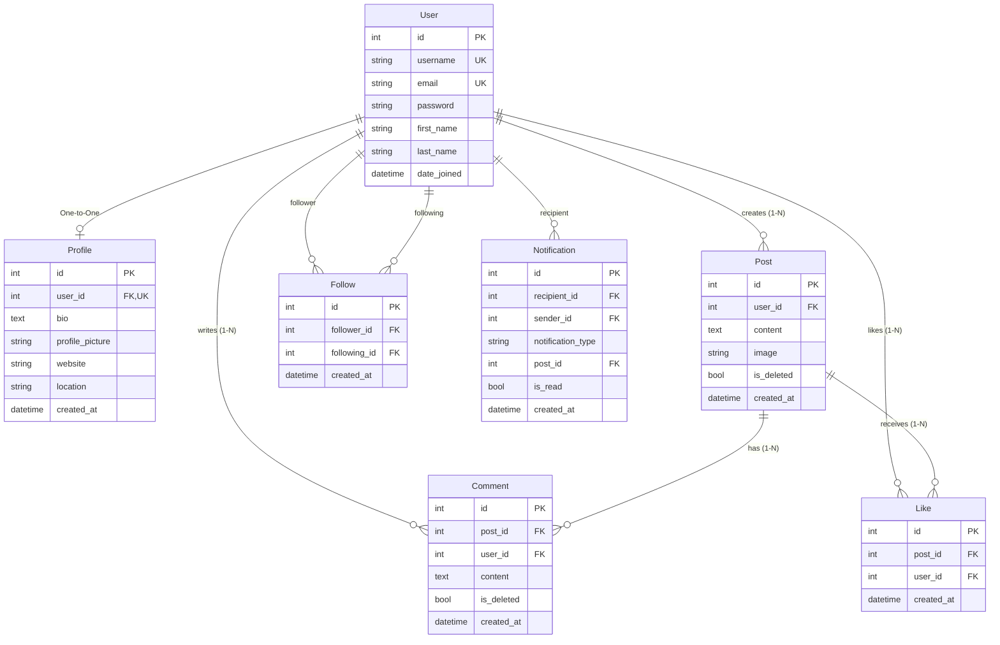

# Connectly — Mini Social Media Platform

<p align="center">
  
</p>

<p align="center">
  <strong>Share · Connect · Grow</strong><br>
  A modern, responsive, and scalable mini social media platform built with <strong>Django</strong>, <strong>Tailwind CSS</strong>, and <strong>JavaScript</strong>.
  <br><br>
  🚀 <strong>Live Demo:</strong> <a href="https://connectly-social-media-plateform.onrender.com/" target="_blank"><strong>connectly-social-media-plateform.onrender.com</strong></a>
</p>

<p align="center">
  <a href="https://connectly-social-media-plateform.onrender.com/"></a>
  
  
  
  
  
  
</p>

---

## 📌 Project Overview

**Connectly** is a full-stack mini social media platform developed for **CodeAlpha (Task 2 — Social Media Platform)**. It demonstrates core principles of full-stack web engineering, database architecture, session authentication, AJAX-driven reactivity, and responsive UI design.

Connectly unites essential social networking capabilities into a single, cohesive experience: user profile customization, chronological and filtered social feeds, rich post creation (with text and image uploads), real-time liking with micro-animations, instant comment threads, follower/following networks, in-app notification alerts, and discovery search.

| Detail | Specification |
|---|---|
| **Organization** | **CodeAlpha** |
| **Internship Task** | **Task 2 — Social Media Platform** |
| **Project Type** | Full-Stack Web Application |
| **Live URL** | [https://connectly-social-media-plateform.onrender.com/](https://connectly-social-media-plateform.onrender.com/) |
| **GitHub Repository** | [shivangsaxena1011/Connectly-Social-Media-Plateform](https://github.com/shivangsaxena1011/Connectly-Social-Media-Plateform) |

---

## 🎯 Project Objectives

- **Full-Stack Architecture:** Build a modular Model-View-Template (MVT) Django application integrated with modern frontend tooling.
- **Robust Authentication:** Provide secure registration, email-or-username login, hashed passwords, and session handling.
- **Relational Data Modeling:** Design a normalized schema with relational integrity, compound indexes, and unique/check constraints.
- **Interactive User Experience:** Deliver fast, page-refresh-free actions (likes, comments, follows) using vanilla JavaScript and the Fetch API.
- **Security & Authorization:** Enforce ownership verification for editing/deletion, strict CSRF validation, and input sanitization.
- **Production Readiness:** Configure WhiteNoise static asset serving, Gunicorn WSGI runtime, automated database migrations, and cloud hosting deployment.

---

## 📊 Infographics & Architecture Diagrams

The project includes complete engineering diagrams, schema designs, and design briefs:

### 1. Implementation Roadmap
Complete development roadmap detailing the step-by-step implementation phases from Day 1 to deployment.
<p align="center">
  
</p>

### 2. Backend Database Schema & ER Model
Normalized database design covering User, Profile, Post, Comment, Like, Follow, and Notification models with integrity rules.
<p align="center">
  
</p>

### 3. UI/UX Design Brief
Color palette (Electric Indigo, Vivid Pink, Emerald Accent), typography (Plus Jakarta Sans & Inter), and component design tokens.
<p align="center">
  
</p>

### 4. Application Flowchart
User journeys covering Registration & Login, Home Feed, Post Creation, Interactions, and Follow workflows.
<p align="center">
  
</p>

### 5. Product Requirements Document (PRD)
Product vision, target personas, MVP requirements, non-functional criteria, and success metrics.
<p align="center">
  
</p>

### 6. Technical Requirements Document (TRD)
High-level system architecture, security considerations, and query optimizations.
<p align="center">
  
</p>

---

## ✨ Features & Capabilities

### 🔐 User Authentication & Account Management
- **Registration & Verification:** Unique username and email validation with duplicate checks and password confirmation.
- **Flexible Login:** Sign in using either username or email address.
- **Session-Based Auth:** Built-in Django session management with secure cookie handling.
- **Protected Views:** Login-required decorators protecting feeds, profiles, settings, and interactive endpoints.
- **Auto-Provisioned Profiles:** Django `post_save` signals automatically create user profiles upon registration.

### 👤 User Profiles & Customization
- **Personalized Header & Bio:** Displays custom avatar, cover gradient, biography, location, and personal website links.
- **Profile Customization (`/profile/edit/`):** Real-time client avatar preview and form validation.
- **Statistics Counters:** Dynamic metrics for post count, follower count, and following count.
- **Content Tabs:** Filter profile views by **Posts**, **Media** (photo-only posts), and **Likes** (posts liked by the user).

### 📝 Posts Management
- **Rich Post Creation:** Create posts with text and optional photo uploads via an in-timeline composer or dedicated modal dialog.
- **Chronological Feeds:** Newest posts appear first with formatted relative timestamps (`naturaltime`).
- **Post Ownership & Soft Deletion:** Edit post content or soft-delete posts (`is_deleted=True`) with author permission verification.
- **Dedicated Thread Pages (`/post/<id>/`):** View full post media, shareable permalink, and complete discussion thread.

### ❤️ Interactive Like System
- **Real-Time AJAX Toggling:** Like and unlike posts without page reloads.
- **Micro-Animations:** Heart pulse animation with dynamic icon filling and immediate counter updates.
- **Database Constraints:** `UniqueConstraint(fields=['post', 'user'])` prevents duplicate likes.

### 💬 Threaded Comments System
- **Instant Commenting:** Submit comments via AJAX with immediate DOM insertion.
- **Author Attribution:** Displays author avatar, name, handle, and timestamp.
- **Moderation & Deletion:** Both comment authors and the post owner have permissions to remove comments.
- **Pre-fetched Comments:** Optimized queries pre-fetch non-deleted comments to prevent N+1 queries.

### 🤝 Follow System & Dual Feed
- **Follow / Unfollow:** Toggle following status across profile pages, suggested lists, and search results.
- **Integrity Constraints:** Database check constraints (`follower != following`) and unique constraints prevent duplicate or self-following.
- **Dual Feed Modes:**
  - **For You:** Global community timeline.
  - **Following:** Curated timeline strictly featuring content from accounts you follow.
- **Followers & Following Directories:** Dedicated screens listing all followers and followed accounts.

### 🔍 Explore, Search & Notifications
- **Explore Hub (`/explore/`):** Discover featured creators and trending posts categorized by topic (Tech, Design, Photography, Community).
- **Global Search (`/search/`):** Search users by name/handle and posts by keyword content.
- **Activity Notifications (`/notifications/`):** In-app notification center alerting users when someone likes their post, comments on their post, or follows them.
- **Dynamic Unread Badge:** Live count of unread notifications in sidebar and mobile navigation.

---

## 🛠 Technology Stack

| Layer | Technology | Details |
|---|---|---|
| **Backend Framework** | **Python 3.14+ / Django 6.1** | MVT pattern, ORM, authentication, form validation, signal dispatchers |
| **Frontend & Styling** | **HTML5, Tailwind CSS 3.4** | Utility-first responsive design following the *Vibrant Connection* design system |
| **Typography & Icons** | **Plus Jakarta Sans, Inter, Material Symbols** | Rounded modern typography and Google Material Symbols |
| **Client Scripting** | **JavaScript (ES6+)** | Fetch API, CSRF cookie handling, DOM manipulation, image previewers |
| **Database & ORM** | **SQLite (Dev) / PostgreSQL (Prod)** | Normalized relational schema managed via Django ORM and `dj-database-url` |
| **Static & Media Serving**| **WhiteNoise, Pillow (PIL)** | In-process static asset delivery with gzip/brotli caching, image validation |
| **WSGI Server** | **Gunicorn 26.2** | High-performance Python WSGI HTTP server |
| **Development & Tools** | **Google Antigravity, VS Code, Git, GitHub** | Local development, testing, source control, and GitHub repository |
| **Deployment Platform** | **Render** | Live cloud production deployment with automated CI/CD pipeline |

---

## 📐 System Architecture & Data Flow

```
[ Client Browser (Desktop / Tablet / Mobile) ]
                      │
           HTTPS (HTML / CSS / JS)
                      ▼
            [ Gunicorn WSGI Server ]
                      │
           [ WhiteNoise (Static Assets) ]
                      │
         [ Django Application Core (MVT) ]
   ├── Authentication & Session Middleware
   ├── CSRF Verification Middleware
   ├── URL Dispatcher (connectly/urls.py)
   ├── View Controllers & AJAX APIs (social/views.py)
   └── Django Signals (Profile auto-creation, Notifications)
                      │
           ┌──────────┴──────────┐
           ▼                     ▼
[ Database Layer ]      [ Media Storage ]
  • SQLite / PostgreSQL    • /media/posts/
  • Normalized Schema      • /media/profiles/
  • Compound Indexes       • Pillow Validation
```

---

## 🗄 Database Design & Schema

The application builds on Django's `auth_user` model alongside 6 custom relational models:



### Constraints & Integrity Rules
- **One Profile per User:** Enforced through `OneToOneField(User)`.
- **Unique Post Likes:** `UniqueConstraint(fields=['post', 'user'])` prevents duplicate likes.
- **Unique Follows & Anti-Self Follow:** `UniqueConstraint(fields=['follower', 'following'])` and `CheckConstraint(condition=~Q(follower=F('following')))` prevent duplicate follows and self-following.
- **Soft Deletion:** Posts and Comments include `is_deleted=models.BooleanField(default=False)` with a custom `ActivePostManager`.

---

## 📁 Project Directory Structure

```text
Connectly- Social Media Plateform/
│
├── connectly/                   # Django Project Root Configuration
│   ├── __init__.py
│   ├── settings.py              # Settings, middleware, WhiteNoise, database config
│   ├── urls.py                  # Global URL dispatcher
│   ├── wsgi.py                  # WSGI entrypoint for Gunicorn
│   └── asgi.py
│
├── social/                      # Core Social Application
│   ├── __init__.py
│   ├── admin.py                 # Admin site setup with soft-delete actions
│   ├── apps.py                  # App config & signal dispatcher registration
│   ├── forms.py                 # UserRegistration, Login, Profile, Post, Comment forms
│   ├── models.py                # Profile, Post, Comment, Like, Follow, Notification models
│   ├── signals.py               # Post-save signals for profile creation & notifications
│   ├── urls.py                  # Application route definitions
│   ├── views.py                 # View controllers & AJAX handlers
│   ├── tests.py                 # Automated unit and integration test suite (14 tests)
│   ├── migrations/              # Database migration history
│   └── templatetags/            # Custom Django template filters (is_liked_by, is_following)
│       ├── __init__.py
│       └── social_tags.py
│
├── templates/                   # Modular Django Templates
│   ├── base.html                # Master layout with responsive navigation & modals
│   ├── registration/
│   │   ├── login.html           # Login screen (supports username or email)
│   │   └── register.html        # Registration screen
│   └── social/
│       ├── feed.html            # Chronological feed with "For You" & "Following" tabs
│       ├── explore.html         # Explore & creator discovery page
│       ├── profile.html         # Public profile with Posts, Media, and Likes tabs
│       ├── profile_edit.html    # Profile & settings customization
│       ├── post_detail.html     # Threaded discussion view
│       ├── post_form.html       # Standalone post creator / editor
│       ├── followers_list.html  # Dedicated followers / following directory
│       ├── notifications.html   # Activity notification center
│       └── search_results.html  # Search results for users and posts
│
├── static/                      # Static Assets
│   ├── css/style.css            # Custom CSS, micro-animations, scrollbar utilities
│   ├── js/app.js                # AJAX handlers (likes, follows, comments, toasts, previews)
│   └── images/                  # Default avatars and placeholder graphics
│
├── staticfiles/                 # Collected static directory for WhiteNoise
│
├── media/                       # User-uploaded media
│   ├── posts/
│   └── profiles/
│
├── docs/                        # Project Documentation & Architecture Graphics
│   ├── images/                  # High-resolution infographics & screen previews
│   ├── PRD.md                   # Product Requirements Document
│   ├── TRD.md                   # Technical Requirements Document
│   ├── ROADMAP.md               # 7-Day Implementation Plan
│   └── FLOWCHART.md             # Application Flowchart Documentation
│
├── Procfile                     # Web process definition for Gunicorn
├── build.sh                     # Production build script (migrate, collectstatic, seed)
├── render.yaml                  # Infrastructure-as-code configuration for Render
├── populate_db.py               # Database seeder with realistic demo accounts & content
├── manage.py                    # Django management script
├── requirements.txt             # Python package dependencies
├── LICENSE                      # MIT License
└── README.md                    # Project documentation
```

---

## ⚡ Quickstart & Installation

### Prerequisites
- **Python 3.10+** (tested up to Python 3.14)
- **pip** package manager
- **Git**

### 1. Clone the Repository
```bash
git clone https://github.com/shivangsaxena1011/Connectly-Social-Media-Plateform.git
cd "Connectly- Social Media Plateform"
```

### 2. Set Up Virtual Environment
```bash
# Windows
python -m venv venv
venv\Scripts\activate

# macOS / Linux
python3 -m venv venv
source venv/bin/activate
```

### 3. Install Dependencies
```bash
pip install -r requirements.txt
```

### 4. Run Database Migrations
```bash
python manage.py migrate
```

### 5. Seed the Database with Realistic Demo Data
Populate 5 demo creator accounts, profile images, sample posts, likes, comments, and follow relationships:
```bash
python populate_db.py
```

### 6. Launch the Local Development Server
```bash
python manage.py runserver
```

Open your browser and visit: **`http://127.0.0.1:8000/`**  
The Django Admin panel is available at: **`http://127.0.0.1:8000/admin/`**

---

## 👥 Demo Accounts

The database seeder automatically creates 5 realistic creator accounts (all passwords: **`connectly123`**):

| Username | Full Name | Role | Email |
|---|---|---|---|
| **`shivang`** | Shivang Saxena | Superuser / Lead Developer | `shivang@connectly.app` |
| **`ananya`** | Ananya Sharma | Product Designer | `ananya@connectly.app` |
| **`rahul`** | Rahul Verma | Full Stack Explorer | `rahul@connectly.app` |
| **`priya`** | Priya Patel | Travel Photographer | `priya@connectly.app` |
| **`alex`** | Alex Chen | Software Architect | `alex@connectly.app` |

---

## 🧪 Automated Testing

Connectly includes a comprehensive automated test suite covering models, soft deletion, unique constraints, self-follow prevention, authentication, email login, and AJAX endpoints:

```bash
python manage.py test
```

### Test Results
```text
Creating test database for alias 'default'...
..............
----------------------------------------------------------------------
Ran 14 tests in 10.593s

OK
Destroying test database for alias 'default'...
```

---

## 🌐 API & URL Endpoints

| URL Pattern | Method | Description |
|---|---|---|
| `/` | `GET` | Home Feed ("For You" and "Following" tabs) |
| `/register/` | `GET`, `POST` | User registration |
| `/login/` | `GET`, `POST` | User login (accepts username or email) |
| `/logout/` | `GET`, `POST` | Session termination |
| `/explore/` | `GET` | Explore trending posts & recommended creators |
| `/profile/<username>/` | `GET` | User profile page (Posts, Media, Likes tabs) |
| `/profile/edit/` | `GET`, `POST` | User profile and biography editor |
| `/profile/<username>/followers/` | `GET` | User followers directory |
| `/profile/<username>/following/` | `GET` | User following directory |
| `/follow/<username>/` | `POST` | Follow / Unfollow toggle (AJAX JSON / redirect) |
| `/post/create/` | `GET`, `POST` | Create post with optional image upload |
| `/post/<id>/` | `GET` | Post detail view with threaded comments |
| `/post/<id>/edit/` | `GET`, `POST` | Edit existing post (author only) |
| `/post/<id>/delete/` | `POST` | Soft-delete post (author only) |
| `/post/<id>/like/` | `POST` | Like / Unlike post toggle (AJAX JSON / redirect) |
| `/post/<id>/comment/` | `POST` | Add comment to post (AJAX JSON / redirect) |
| `/comment/<id>/delete/` | `POST` | Delete comment (author or post owner) |
| `/notifications/` | `GET` | In-app activity notifications |
| `/search/` | `GET` | Search users and posts by keyword |

---

## 🔒 Security & Data Integrity

- **Password Hashing:** Django PBKDF2 with SHA-256 password hashing.
- **Cross-Site Request Forgery (CSRF):** Enforced on all mutation requests and AJAX headers via `X-CSRFToken`.
- **Strict Authorization:** Server-side ownership validation prevents unauthorized editing or deleting of posts and comments.
- **SQL Injection Prevention:** 100% parameterized queries via Django ORM.
- **Relational Integrity:** Unique constraints prevent duplicate likes and duplicate follows; database check constraints prevent self-following.
- **Environment Variables:** Sensitive parameters (`DJANGO_SECRET_KEY`, `DATABASE_URL`) isolated from version control.

---

## 💡 Learning Outcomes (Internship Experience)

Working on Connectly as part of the **CodeAlpha Internship Program (Task 2)** provided hands-on experience in:

- **End-to-End Web Development:** Architecting full-stack applications with Python, Django, and modern frontend tools.
- **Relational Schema Engineering:** Implementing normalized database models, compound indexes, and database integrity constraints.
- **Asynchronous User Interactions:** Combining Django view controllers with vanilla JavaScript Fetch API for real-time feed updates.
- **State & Session Management:** Managing user authentication, permissions, and signals for automated background tasks.
- **Production Deployment Workflows:** Preparing applications for live cloud deployment with Gunicorn, WhiteNoise, and Render.
- **Software Quality Assurance:** Writing automated unit and integration tests to validate security, constraints, and edge cases.

---

## 🔮 Future Enhancements

- [ ] **Direct Messaging (DMs):** Private chat between mutual followers.
- [ ] **Real-Time WebSockets:** Live timeline streaming via Django Channels.
- [ ] **Post Bookmarking:** Personal saved collections.
- [ ] **Hashtags & Mentions:** Automated hashtag indexing and user `@mention` tagging.
- [ ] **Dark Mode:** System and manual dark theme switcher.
- [ ] **Cloud Object Storage:** Integration with AWS S3 or Cloudinary for scalable media uploads.

---

## 🏆 Acknowledgement

Special thanks to **CodeAlpha** for providing the opportunity to work on this project as part of the **CodeAlpha Internship Program**.

---

## 📄 License

This project is licensed under the **MIT License** — see the [LICENSE](LICENSE) file for details.
